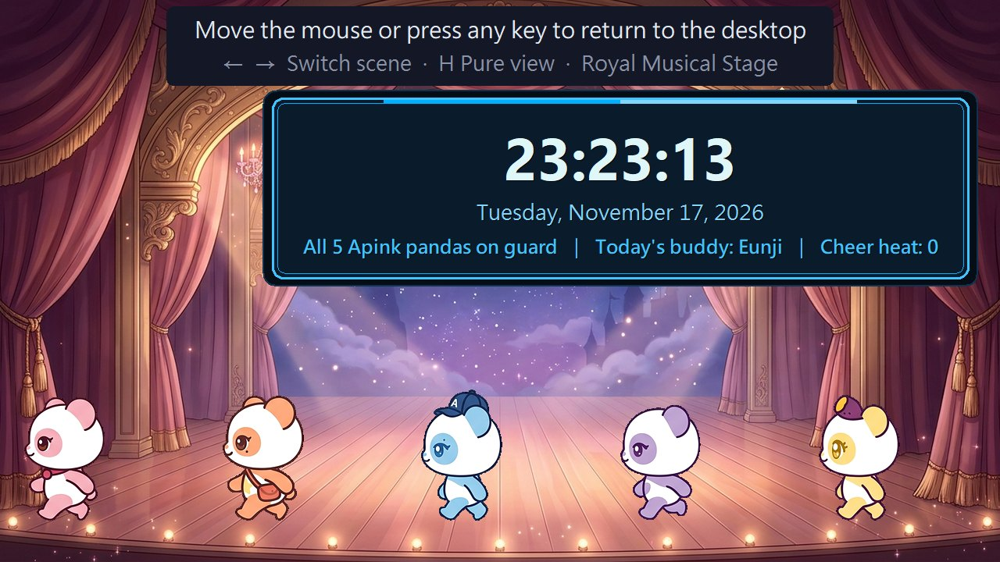

# PandaDesktopPet · Apink 熊貓桌面寵物

非官方、非營利粉絲創作（Windows 桌面小寵物） / 비공식·비영리 팬 창작물 (Windows 데스크톱 펫) / Unofficial, non-commercial fan project (Windows desktop pet).




[繁體中文](#繁體中文) · [한국어](#한국어) · [English](#english) · [開發 / 개발 / Development](#development)

---

**繁中聲明：**本專案是非官方、非營利粉絲創作，與 Apink 或其經紀公司無合作關係，未取得權利人授權。不販售、不投放廣告、不接受贊助，亦無付費功能。權利人可透過本專案 GitHub Issues 聯繫（詳見 [ASSETS-LICENSE.md](ASSETS-LICENSE.md)），收到通知後將立即停止相關素材散布並下架。非營利不代表取得授權。

**한국어 안내:** 본 프로젝트는 영리 목적이 없는 비공식 팬 창작물입니다. Apink 및 소속사와 제휴 관계가 없으며, 공식 승인이나 이용 허락을 받지 않았습니다. 판매·광고·후원·유료 기능을 운영하지 않습니다. 권리자는 이 저장소의 GitHub Issues로 문의해 주시면([ASSETS-LICENSE.md](ASSETS-LICENSE.md) 참고) 관련 소재의 배포를 즉시 중단하고 삭제하겠습니다. 비영리 목적이라는 사실이 이용 허락을 의미하지는 않습니다.

**English notice:** This unofficial, non-commercial fan project has no sales, advertising, donations, or paid features. It is not affiliated with or endorsed by Apink or their management agencies; no authorization has been obtained from the rights holders. Rights holders may contact us via this repository's GitHub Issues (see [ASSETS-LICENSE.md](ASSETS-LICENSE.md)), and distribution of the relevant assets will stop immediately with prompt removal. Non-commercial use does not imply permission.

---

## 繁體中文

### 系統需求與下載快速上手

- **支援環境**：僅支援 **Windows 10 / 11（64-bit）**，不支援 macOS、Linux 或手機裝置。
- **已測試環境**：Windows 10 / 11（64-bit）、96–192 DPI（100%–200% 縮放）、單螢幕與雙螢幕。

1. **請只從本專案官方 GitHub Releases 下載，切勿下載不明轉載。**從目前儲存庫點選 Releases，確認擁有者與專案名稱一致（實際檔案以該次 Release 頁面附件為準）。
2. 提供兩種版本（皆**不需要安裝 Python**）：
   - **免安裝版** `PandaDesktopPet-portable.zip`：核對 SHA-256 後完整解壓縮，執行 `PandaDesktopPet/PandaDesktopPet.exe`（請保留旁邊的 `_internal` 資料夾，不要直接在 ZIP 裡執行）。
   - **安裝版** `PandaDesktopPet-Setup.exe`：核對 SHA-256 後執行安裝（預設安裝至 `%LOCALAPPDATA%\Programs\PandaDesktopPet`，免系統管理員權限）。
3. 首次啟動可輸入暱稱；生日可略過，之後可在設定隨時修改。

**不用輸入路徑的 SHA-256 核對法：**開啟 PowerShell，輸入 `Get-FileHash `（後面空一格），把下載的 `.zip` 或 `.exe` 拖進視窗，再按 Enter。核對完整英數字是否與同一個官方 Release 的 `SHA256SUMS.txt` 或 GitHub 自動顯示於該附件旁的 SHA-256 完全相同；不一致就不要執行，請重新從官方發布頁下載，切勿混用不同版本的雜湊。

```powershell
Get-FileHash "下載檔案的完整路徑.zip" -Algorithm SHA256
certutil -hashfile "下載檔案的完整路徑.zip" SHA256
```

**SmartScreen 與防毒誤報提醒：**
- 若 Windows SmartScreen 警告未識別程式，請先核對官方來源與 SHA-256，確認無誤後再從「其他資訊」決定是否執行；請勿停用系統整體防護。
- PyInstaller 打包的 `.exe` 偶爾可能被 Windows Defender 或防毒軟體誤判隔離。若確認來源與 SHA-256 無誤，但解壓縮後發現 `PandaDesktopPet.exe` 消失，可至「Windows 安全性 → 病毒與威脅防護 → 保護歷程記錄」查看是否遭到隔離。

### 功能特色

- 五位熊貓：初瓏（隆咚 / Rongdoong）、普美（普咚 / Bbomdoong）、恩地（恩咚 / Meungdoong）、南珠（南咚 / Namdoong）、夏榮（夏咚 / Hadoong）；支援自動輪值或手動選角，小 / 中 / 大尺寸與高 DPI 縮放。
- 走路、睡覺、餵食、氣泡陪伴互動、角色檔案卡、生日提醒、節慶換裝、跨年倒數與五人集體慶祝；內建 **56 種食物**。
- **14 個待機畫面 = 4 個手繪動態場景 + 10 張插畫桌布**（占卜室已包含在這 10 張內；另有獨立恩地塔羅占卜對話框，不另算一張待機桌布）。
- 大巨蛋棒球應援、普美正面歡呼、恩地個唱想像舞台 **8 套服裝（含開場服裝）**；粉絲想像場景不代表真實演出公告，占卜僅供娛樂。
- **4 款自訂游標 + 1 個系統預設選項**，可僅程式內或全域套用，正常退出時自動還原全域游標。支援繁體中文 / 韓文 / 英文即時切換。

### 操作、設定與移除

- 拖曳移動熊貓，右鍵開啟選單。預設全域待機快捷鍵 **Ctrl+Shift+S**（可於設定修改）；**F9** 僅在桌寵視窗取得焦點時切換待機。
- 待機模式下，左右方向鍵切換場景；**H** 鍵隱藏或顯示時鐘與提示（熊貓仍保留）；其他按鍵或滑鼠移動離開待機，帶修飾鍵的組合不作一般換景操作。
- 透過**系統匣（工作列右下角圖示）右鍵選單**可顯示／隱藏或結束程式。
- **全域游標異常復原**：若程式異常崩潰、遭強制結束或系統異常關機導致全域自訂游標未自動還原，可開啟 Windows「控制台 → 滑鼠（滑鼠內容）→ 指標 → 使用預設值 → 套用」一鍵恢復系統預設指標，或重新啟動桌寵後於設定將游標切回「系統預設」。
- **解除安裝**：安裝版可透過 Windows「設定 → 應用程式」解除安裝；免安裝版請先在設定停用開機自啟並退出程式，再刪除程式資料夾。若要一併清除暱稱、生日、設定與餵食紀錄，請手動刪除 `%APPDATA%\PandaDesktopPet`。

### 隱私與系統存取說明

- **本機儲存位置**：暱稱、生日、個人設定與餵食紀錄僅保存在本機 `%APPDATA%\PandaDesktopPet`。
- **通知轉報功能存取範圍**：本程式內建「系統通知轉報」功能（**預設開啟**，可於設定隨時關閉，亦可開啟「隱私模式」遮蔽內文），用途是讓熊貓以氣泡提醒你 Windows 新通知（如 Outlook、Teams、LINE、Discord、Telegram 等）。此功能僅以 SQLite 唯讀模式（`?mode=ro`、`query_only=ON`）讀取本機 `%LOCALAPPDATA%\Microsoft\Windows\Notifications\wpndatabase.db`，不會修改或刪除系統通知，最近 20 則僅暫存於記憶體（RAM），關閉程式或清空抽屜即消失，不寫入硬碟。
- **網路連線行為**：本程式為 **100% 本機離線執行**，原始碼不含任何網路連線呼叫，沒有遙測、分析追蹤、自動上傳或背景連網檢查更新。
- **資料刪除方式**：直接刪除 `%APPDATA%\PandaDesktopPet` 即可徹底移除所有使用者資料。

### 常見問題（FAQ）

1. **解壓縮後找不到 `PandaDesktopPet.exe` 或無法啟動？**
   請先確認已完整解壓縮（不要直接在 ZIP 內點兩下執行）且 `_internal` 資料夾與 `.exe` 在同一層；若 `.exe` 消失，請確認下載來源與 SHA-256 無誤後，至「Windows 安全性 → 保護歷程記錄」檢查是否被誤判隔離。
2. **啟動後畫面上找不到熊貓？**
   請至工作列右下角的系統匣圖示按右鍵，確認未處於隱藏狀態或重新顯示／重置位置（外接螢幕拔除後也可能暫時停在原螢幕座標）。
3. **Windows SmartScreen 跳出「Windows 已保護您的電腦」？**
   這是未購買商用程式碼簽章的免費開源程式常見提示。請務必先核對官方 GitHub Releases 來源與 SHA-256 完全一致，再點「其他資訊 → 仍要執行」。
4. **高 DPI（150% / 200%）或多螢幕顯示比例不合？**
   可於右鍵選單調整熊貓尺寸（小 / 中 / 大）與文字縮放；待機模式支援雙螢幕自動覆蓋與獨立縮放。
5. **強制關閉程式後滑鼠游標還停留在熊貓手掌？**
   開啟 Windows「滑鼠內容 → 指標」點選「使用預設值」並套用即可立即還原，或重開桌寵後在設定切回系統預設游標。

### 素材與授權

程式碼採用 [MIT](LICENSE) 授權；角色、桌布、游標、台詞與文件介紹截圖另受 [ASSETS-LICENSE.md](ASSETS-LICENSE.md) 約束。`assets.pak` 僅為索引封裝，**不是加密或 DRM**，亦不代表第三方授權；請勿抽出素材另作他用。

---

## 한국어

### 시스템 요구 사항 및 다운로드 빠른 시작

- **지원 환경**: **Windows 10 / 11 (64-bit)** 전용이며 macOS, Linux 및 모바일 기기는 지원하지 않습니다.
- **테스트 환경**: Windows 10 / 11 (64-bit), 96-192 DPI (100%-200% 배율), 단일 및 듀얼 모니터.

1. **이 프로젝트의 공식 GitHub Releases에서만 다운로드하세요. 출처가 불분명한 재배포 파일은 받지 마세요.** 현재 저장소에서 Releases를 열고 소유자와 프로젝트 이름을 확인하세요(실제 제공 파일은 해당 Release 페이지 첨부 파일 기준).
2. 두 가지 배포 방식을 제공합니다(모두 **Python 설치 불필요**):
   - **포터블 ZIP** `PandaDesktopPet-portable.zip`: SHA-256 확인 후 전체 압축을 풀고 `PandaDesktopPet/PandaDesktopPet.exe`를 실행하세요(`_internal` 폴더를 함께 보관하고 ZIP 안에서 바로 실행하지 마세요).
   - **설치 프로그램** `PandaDesktopPet-Setup.exe`: SHA-256 확인 후 실행해 설치하세요(기본 설치 경로 `%LOCALAPPDATA%\Programs\PandaDesktopPet`, 관리자 권한 불필요).
3. 처음 실행할 때 닉네임을 입력할 수 있으며, 생일은 생략하거나 나중에 설정에서 변경할 수 있습니다.

**경로를 직접 입력하지 않는 SHA-256 확인 방법:** PowerShell을 열고 `Get-FileHash `를 입력하세요(끝에 공백 한 칸). 다운로드한 `.zip` 또는 `.exe`를 창으로 끌어다 놓고 Enter를 누르세요. 전체 문자열을 같은 공식 Release의 `SHA256SUMS.txt` 또는 GitHub가 첨부 파일 옆에 표시하는 SHA-256과 비교하세요. 다르면 실행하지 말고 공식 페이지에서 다시 받으세요. 서로 다른 버전의 해시와 비교하지 마세요.

```powershell
Get-FileHash "다운로드한 파일의 전체 경로.zip" -Algorithm SHA256
certutil -hashfile "다운로드한 파일의 전체 경로.zip" SHA256
```

**SmartScreen 및 백신 오탐 안내:**
- Windows SmartScreen 경고가 나타나면 공식 출처와 SHA-256을 먼저 확인한 뒤 '추가 정보'에서 실행 여부를 결정하세요. 시스템 보안 기능 전체를 끄지 마세요.
- PyInstaller로 패키징된 `.exe`는 Windows Defender나 백신 프로그램에서 간혹 오탐 격리될 수 있습니다. 공식 출처와 SHA-256을 확인했는데 압축 해제 후 `.exe`가 보이지 않는다면 'Windows 보안 -> 바이러스 및 위협 방지 -> 보호 기록'에서 확인하세요.

### 기능

- 다섯 멤버 판다: 초롱 (롱둥이 / Rongdoong), 보미 (뽐둥이 / Bbomdoong), 은지 (믕둥이 / Meungdoong), 남주 (남둥이 / Namdoong), 하영 (하둥이 / Hadoong). 자동 순환 또는 수동 선택, **작게 / 보통 / 크게** 크기와 높은 DPI 배율을 지원합니다.
- 걷기, 잠자기, 먹이 주기, 말풍선 응원 문구, 프로필 카드, 생일 알림, 명절 의상, 새해 카운트다운과 단체 축하. 음식은 **56종**입니다.
- **대기 화면 14개 = 직접 그린 장면 4개 + 일러스트 배경 10개**. 점술방은 이 10개에 포함되며, 별도의 은지 점술 대화창은 추가 배경으로 세지 않습니다.
- 돔 야구 응원, 보미의 정면 응원, 은지의 상상 속 솔로 콘서트 **의상 8벌 (오프닝 포함)**. 실제 공연 공지가 아닌 팬 창작 장면이며, 점술은 오락용입니다.
- **사용자 지정 커서 4종 + 시스템 기본값 1개**, 앱 내부 또는 전역 적용과 정상 종료 시 전역 커서 자동 복원. 번체 중국어 / 한국어 / 영어를 즉시 전환합니다.

### 조작, 설정과 삭제

- 드래그로 이동하고 오른쪽 클릭으로 메뉴를 엽니다. 기본 전역 대기 단축키 **Ctrl+Shift+S**는 설정에서 변경할 수 있고, **F9**는 판다 창에 포커스가 있을 때만 작동합니다.
- 대기 중 좌우 방향키로 장면을 바꿉니다. **H**는 시계와 안내를 숨기거나 표시하며 판다는 계속 보입니다. 다른 키나 마우스 조작으로 종료되며, 보조 키 조합은 일반 장면 전환으로 처리하지 않습니다.
- 작업 표시줄 오른쪽 아래 시스템 트레이 아이콘의 오른쪽 클릭 메뉴에서 종료할 수 있습니다.
- **전역 커서 비정상 종료 시 복구**: 강제 종료, 오류 또는 예기치 않은 전원 차단으로 전역 커서가 복구되지 않았다면 Windows '제어판 -> 마우스 (마우스 속성) -> 포인터 -> 기본값 사용 -> 적용'으로 복구하거나, 앱을 다시 열어 커서를 시스템 기본값으로 전환하세요.
- **제거 방법**: 설치 버전은 Windows '설정 -> 앱'에서 제거할 수 있습니다. 포터블 버전은 자동 시작을 끄고 종료한 뒤 프로그램 폴더를 삭제하세요. 닉네임, 생일, 설정과 기록까지 지우려면 `%APPDATA%\PandaDesktopPet` 폴더를 삭제하세요.

### 개인정보 및 시스템 접근 안내

- **로컬 저장 위치**: 닉네임, 생일, 설정 및 먹이 기록은 로컬 `%APPDATA%\PandaDesktopPet`에만 저장됩니다.
- **알림 전달 기능 접근 범위**: 새 Windows 알림(Outlook, Teams, LINE, Discord, Telegram 등)을 말풍선으로 알려 주는 기능이며 **기본값으로 켜져 있습니다**(설정에서 언제든 끌 수 있으며 '개인정보 보호 모드'로 본문 가리기 가능). `%LOCALAPPDATA%\Microsoft\Windows\Notifications\wpndatabase.db`를 SQLite 읽기 전용(`?mode=ro`, `query_only=ON`)으로만 읽으며 최근 20건만 메모리(RAM)에 임시 보관하고 디스크에 저장하지 않습니다.
- **네트워크 동작**: **100% 오프라인 로컬 실행**이며 네트워크 연결 코드, 원격 측정(텔레메트리), 자동 업로드 또는 자동 업데이트 확인 기능이 전혀 없습니다.
- **데이터 삭제**: `%APPDATA%\PandaDesktopPet` 폴더를 삭제하면 모든 사용자 데이터가 완전히 제거됩니다.

### 자주 묻는 질문 (FAQ)

1. **압축을 풀었는데 `PandaDesktopPet.exe`가 사라졌거나 실행되지 않습니다.**
   ZIP 안에서 바로 실행하지 말고 전체 압축을 풀었는지, `_internal` 폴더가 함께 있는지 확인하세요. `.exe`가 사라졌다면 공식 출처와 SHA-256을 확인한 뒤 'Windows 보안 -> 보호 기록'을 확인하세요.
2. **실행했는데 화면에 판다가 보이지 않습니다.**
   작업 표시줄 오른쪽 아래 시스템 트레이 아이콘을 오른쪽 클릭해 숨김 상태를 해제하거나 위치를 재설정해 보세요.
3. **SmartScreen 경고가 표시됩니다.**
   상용 코드 서명이 없는 무료 팬 프로젝트에서 흔히 나타나는 안내입니다. 공식 Releases 출처와 SHA-256을 확인한 뒤 '추가 정보 -> 실행'을 선택하세요.
4. **고해상도 DPI (150% / 200%)나 듀얼 모니터에서 크기가 어색합니다.**
   오른쪽 클릭 메뉴에서 판다 크기 (작게 / 보통 / 크게)와 글자 배율을 조절할 수 있습니다.
5. **강제 종료 후 마우스 커서가 원래대로 돌아오지 않습니다.**
   Windows '마우스 속성 -> 포인터 -> 기본값 사용 -> 적용'을 누르거나 앱을 다시 실행해 커서를 시스템 기본값으로 바꾸세요.

### 소재와 라이선스

코드는 [MIT](LICENSE), 캐릭터·배경·커서·문구·문서 소개 이미지는 [ASSETS-LICENSE.md](ASSETS-LICENSE.md)를 따릅니다. `assets.pak`은 인덱스 묶음이며 **암호화나 DRM이 아닙니다**. 제삼자의 이용 허락을 의미하지 않으며 소재를 추출해 다른 용도로 쓰지 마세요.

---

## English

### System requirements and quick start

- **Supported OS**: **Windows 10 / 11 (64-bit)** only. macOS, Linux, and mobile devices are not supported.
- **Tested environments**: Windows 10 / 11 (64-bit), 96-192 DPI (100%-200% scaling), single and dual monitors.

1. **Download only from this project's official GitHub Releases. Avoid unknown mirrors and reposts.** Open Releases from this repository and verify the owner and project name (available files follow the attachments on that Release page).
2. Two packages are provided (**no Python installation required**):
   - **Portable ZIP** (`PandaDesktopPet-portable.zip`): verify its SHA-256, extract the entire archive, and run `PandaDesktopPet/PandaDesktopPet.exe` (keep `_internal` beside it; do not run inside the ZIP).
   - **Installer** (`PandaDesktopPet-Setup.exe`): verify its SHA-256 and run setup (installs per-user to `%LOCALAPPDATA%\Programs\PandaDesktopPet` with no administrator privileges required).
3. Enter a nickname on first launch if you wish; your birthday is optional and editable in Settings.

**Verify SHA-256 without typing a path:** Open PowerShell, type `Get-FileHash ` with a trailing space, drag the downloaded `.zip` or `.exe` into the window, and press Enter. Compare the entire string with `SHA256SUMS.txt` from the same official Release or the SHA-256 shown next to that attachment on GitHub. If they differ, do not run it; download again from the official page. Never compare hashes across different versions.

```powershell
Get-FileHash "full path to your downloaded file.zip" -Algorithm SHA256
certutil -hashfile "full path to your downloaded file.zip" SHA256
```

**SmartScreen & antivirus false-positive notice:**
- If Windows SmartScreen warns about an unrecognized app, verify the official source and SHA-256 before deciding whether to continue via More info. Do not disable overall system protection.
- PyInstaller-packaged `.exe` binaries can occasionally be quarantined by Windows Defender or antivirus tools. After verifying the official source and SHA-256, if `PandaDesktopPet.exe` disappears after extraction, check **Windows Security -> Virus & threat protection -> Protection history**.

### Features

- Five pandas: Chorong (Rongdoong), Bomi (Bbomdoong), Eunji (Meungdoong), Namjoo (Namdoong), and Hayoung (Hadoong); automatic rotation or manual selection, Small / Medium / Large sizes, and high-DPI scaling.
- Walking, sleeping, feeding, encouraging speech bubbles, profile cards, birthday reminders, seasonal outfits, New Year countdowns, and group celebrations; **56 foods**.
- **14 standby views = 4 drawn scenes + 10 illustrated wallpapers**. The fortune room is included in those ten; the separate Eunji fortune dialog is not counted as an additional wallpaper.
- Dome baseball cheering, Bomi's front-facing cheer, and **8 outfits (including the opening outfit)** for Eunji's imagined solo concert. These fan-created scenes are not real concert announcements, and fortune readings are for entertainment only.
- **4 custom cursors + 1 system-default option**, app-only or global, with automatic global cursor restoration on normal exit. Live Traditional Chinese / Korean / English switching.

### Controls, settings, and removal

- Drag to move; right-click for the menu. The default configurable global standby shortcut is **Ctrl+Shift+S**. **F9** works only while the pet window has focus.
- In standby, Left / Right arrow keys switch scenes, **H** toggles the clock and hints while keeping the pandas visible, and other keys or mouse movement exit (modified key combinations are not treated as ordinary scene switches).
- Exit from the system tray icon context menu (bottom-right of the taskbar).
- **Recovering a stuck global cursor**: if the app crashes, is force-killed, or the PC loses power before normal exit restores the cursor, open Windows **Mouse Properties -> Pointers -> Use Default -> Apply**, or relaunch the app and switch the cursor back to System Default.
- **Removal**: uninstall the Setup version via Windows **Settings -> Apps**. For the portable version, disable autostart, exit, and delete the program folder. Delete `%APPDATA%\PandaDesktopPet` as well to remove nickname, birthday, settings, and history.

### Privacy & system access

- **Local storage**: nickname, birthday, settings, and feed logs are stored locally under `%APPDATA%\PandaDesktopPet`.
- **Notification relay scope**: the notification bubble relay (**enabled by default**; can be turned off anytime in Settings, with an optional Privacy Mode that masks body text) lets the panda notify you of new Windows toast notifications (Outlook, Teams, LINE, Discord, Telegram, etc.). It opens `%LOCALAPPDATA%\Microsoft\Windows\Notifications\wpndatabase.db` in strict SQLite read-only mode (`?mode=ro`, `query_only=ON`), never modifies or deletes system notifications, and keeps only the latest 20 entries in RAM (cleared on exit or Clear Drawer; never written to disk).
- **Network behavior**: **100% offline local execution**. The source code contains no network imports or outbound calls, no telemetry, no analytics, and no background update checks.
- **Deleting your data**: delete `%APPDATA%\PandaDesktopPet` to remove all stored user data.

### FAQ

1. **`PandaDesktopPet.exe` disappeared after extraction or fails to start?**
   Extract the entire ZIP rather than running from inside it, and keep `_internal` next to the `.exe`. If the `.exe` is missing, verify the official source and SHA-256, then check **Windows Security -> Protection history**.
2. **I launched the app but cannot see the panda on screen?**
   Right-click the system tray icon at the bottom-right of the taskbar to unhide or reset position (useful after disconnecting an external monitor).
3. **Windows SmartScreen shows an unrecognized app warning?**
   This is common for unsigned free fan apps. Verify the official GitHub Releases source and SHA-256 first, then choose **More info -> Run anyway**.
4. **High DPI (150% / 200%) or multi-monitor sizing looks off?**
   Adjust pet size (Small / Medium / Large) and text scale in the right-click menu; standby automatically covers and scales across dual monitors.
5. **Global cursor stayed on the panda paw after a forced kill?**
   Open Windows **Mouse Properties -> Pointers -> Use Default -> Apply**, or reopen the app and switch cursor to System Default.

### Assets and licensing

Code is [MIT licensed](LICENSE). Characters, wallpapers, cursors, text, and documentation screenshots follow [ASSETS-LICENSE.md](ASSETS-LICENSE.md). `assets.pak` is an indexed container, **not encryption or DRM**, and grants no third-party permission. Do not extract assets for other uses.

---

<a id="development"></a>
## 開發 / 개발 / Development

Source use requires Windows 10/11 (64-bit), Python, and `requirements.txt`. The portable ZIP and Setup installer run without Python. Source runs enable the `F12` debug panel and manual previews by default; packaged builds disable them by default (`PANDA_DEV=1` or `PANDA_DEV=0` overrides `developer_mode` in either build). Note: when testing new source changes locally, source launchers may prefer an existing `dist` EXE—always run `python -B -X utf8 app/main.py` directly or rebuild `dist` rather than judging new source behavior with an older EXE.

```powershell
python -B -X utf8 -m pip install -r requirements.txt
python -B -X utf8 app/main.py
```

### Full Export vs. Code-only Export (`--no-assets`)

```powershell
python -B -X utf8 tools/export_public_repo.py ..\PandaDesktopPet-public
python -B -X utf8 tools/export_public_repo.py ..\PandaDesktopPet-code --no-assets
```

- **Full Export** (default): includes approved runtime assets (`work/`), ready to run `python -B -X utf8 app/main.py` directly. Run `python -B -X utf8 tools/runtime_manifest.py --list` to verify runtime files.
- **Code-only Export (`--no-assets`)**: includes source code, tests, `installer/PandaDesktopPet.iss`, and the three reviewed documentation JPGs only—no `work/` artwork, cursors, or `assets.pak`. Intended for code review, architecture inspection, and asset-free unit tests (`python -B -X utf8 -m unittest discover -s tests -v`); it cannot launch the full desktop pet until approved runtime assets are supplied. Asset-dependent tests live under `asset_tests/`, and private-workshop checks under `workshop_tests/`.

### Testing & Packaging

- Run Tk tests **serially** with `PANDA_DATA_DIR`, `APPDATA`, `LOCALAPPDATA`, `TEMP`, `TMP`, and `USERPROFILE` redirected to a disposable temporary directory so real settings are never touched.
- Registry check (private workshop): `python -B -X utf8 tools/scan_asset_registry.py --check`.
- Build & provenance: `python -B -X utf8 -m PyInstaller --noconfirm --clean PandaDesktopPet.spec`, then `python -B -X utf8 tools/build_provenance.py dist/PandaDesktopPet`. The output folder includes `README.txt` (UTF-8 with BOM), `LICENSE`, and `ASSETS-LICENSE.md` (UTF-8 without BOM). Installer build uses `installer/PandaDesktopPet.iss` (Inno Setup 6).
- Maintainer release checklist: see `docs/PUBLIC_RELEASE_CHECKLIST.md` (workshop internal / docs).

---

## 回報與版本紀錄 / 문의 및 릴리스 / Feedback & Releases

- **Bug 回報、功能建議與權利／安全回報 (Bug reports, feature requests, rights & security)**: 請至本專案 GitHub Issues 提交 / 이 저장소의 GitHub Issues를 이용해 주세요 / Please open an issue in this repository's GitHub Issues.
- **版本更新紀錄 (Releases & Changelog)**: 請見本專案 GitHub Releases 頁面（各版本發版說明與對應 `SHA256SUMS.txt` 皆附於該次 Release）。
